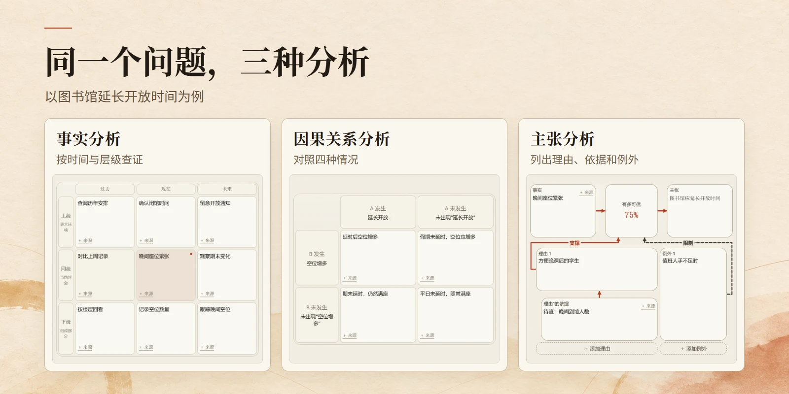

# 合理吗 · V0.3


当前版本为 `0.3.0`（2026-11-21）。这一版更新了页面切换、首页入口与教程交互，精简三种分析的输入和编辑界面。窄屏上的主张图保留支撑与限制的连线，理由和例外等宽排列。

助手首次使用默认显示，支持触摸注视、注视时眨眼和文字区域自动避让。

开发入口：[接口文档](API.md) · [助手行为预设](src/ai/agent-preset.md) · [构建与部署记录](https://github.com/KITAI19019/heli-ma/actions/workflows/deploy.yml)。

整理事实、检查因果关系与主张，记录自己的判断。一个支持离线使用的 PWA，分析记录保存在当前浏览器的本地 SQLite 数据库中。

[打开应用](https://kitai19019.github.io/heli-ma/) · [GitHub 仓库](https://github.com/KITAI19019/heli-ma)

## 版本展示

以「图书馆是否该延长开放时间」为例，展示事实分析的九宫格、因果关系的四种对照，以及主张分析中的理由、依据与例外。



AI 助手可以把用户提供的材料填入主张分析草稿，用户检查后点击「完成」保存。图中的对话为演示。


## 功能

- **事实分析**：用过去、现在、未来与不同层级组成的九宫格整理信息，可为每格添加来源。
- **因果关系分析**：对照 A 与 B 发生或未发生的四种组合，检查因果说法。
- **主张分析**：整理事实、理由、依据和例外，用 0–100% 表达判断程度。
- **历史记录**：点击「完成」才正式保存；继续编辑更新同一条记录，信息不足的判断标记为「待分析」。点击统一的「编辑」按钮后，可单条删除、跨页多选及全选本页后批量删除，删除前需确认。
- **主题**：跟随系统、浅色、深色；可选择首页插图预设，也可使用自己的图片。
- **AI 辅助填写**：侧栏“AI 配置”支持 DeepSeek、OpenAI、Gemini 和自定义 OpenAI 兼容服务。填写密钥自动读取模型列表；启用后通过可拖动、可缩放的小球交流。首先支持主张整理，并可调用现有页面与文字接口。覆盖原文需确认，检查后仍需点击“完成”保存。
- **操作教程**：目录提供事实、因果关系、主张的四步教程，以及九步 AI 助手教程。AI 教程以 DeepSeek 为例，含官方平台密钥截图、配置、辅助填写和手动保存；截图可放大。功能页面右上角的「教程」直达对应分析教程，返回保留当前输入。目录与详情原位淡出淡入；点击进度条可直接跳到指定步骤，也可用按钮或触摸滑动逐页阅读。
- **离线使用**：首次联网加载并缓存完成后，可离线打开、分析与保存；支持 PWA 的浏览器可将应用安装到设备。

界面支持手机与宽屏，目前使用中文。教程以步骤分页阅读；窗口过矮或放大文字时，步骤正文可在内部滚动，翻页按钮保持可用。

页面按可见窗口高度分配空间。初始输入框随文字增高，达到可用高度上限后在框内滚动。窄屏上，事实分析按时间分组，因果关系按组合排列卡片，主张分析保留连接线并将主张放在图的上方。分析内容连续滚动，合理度与完成按钮仍可操作。理由和例外连续排列，多条来源在同一个编辑弹窗中填写。分析页空间较小时，输入框展开到独立编辑层并保留确认按钮。

手机系统返回手势及浏览器返回会优先关闭弹窗、设置页面或历史编辑模式，再按应用内路径返回。分析与输入之间返回会保留当前内容；离开未完成的输入需确认。已保存结果返回首页或其来源历史列表，首页仍可正常返回并离开应用。浏览器前进不会恢复已放弃的草稿。

## 数据保存

应用无账号、后台数据库或跨设备同步。SQLite 通过 sql.js 在浏览器中运行，数据库文件存入 IndexedDB；分析输入暂存于 sessionStorage。上传的主题图片也只保存在当前浏览器。

首次使用默认显示助手，主动关闭后会记住选择；显示小球不发送消息。使用 AI 时浏览器直接连接所选服务，需配置密钥与模型，并具备网络与服务端跨域支持。密钥默认保留本次会话，可选择在设备上记住。发送消息会附带当前分析及最近对话，完整历史库不会整库发送。具体协议、数据范围与工具权限见 [接口文档](API.md#ai-配置与调用)，助手行为预设见 [agent-preset.md](src/ai/agent-preset.md)。

保存包含事务和修订冲突检查，防止多个窗口覆盖同一条记录。保存失败时保留输入。回首页并确认放弃会清除当前草稿，已完成的记录仍保留。

浏览器按站点来源隔离存储，本地开发地址与线上站点的数据各自独立。清除站点数据会删除记录与自定义图片；当前版本尚无导入导出功能。

## 本地运行

建议使用 Node.js 24 LTS，最低 Node.js 22.12。

```sh
npm ci --ignore-scripts
npm run dev
```

开发地址为 <http://127.0.0.1:5178/>。

```sh
npm run typecheck
npm run format:check
npm run build
npm run preview
```

生产预览地址为 <http://127.0.0.1:4178/>。离线能力需在生产构建中验证，开发模式不注册 Service Worker。

## 项目结构

```text
.github/workflows/deploy.yml   GitHub Pages 自动构建与部署
API.md                        程序调用入口、页面路径、字段与示例
public/                       品牌图标与 PWA manifest
public/tutorials/deepseek/     官方平台操作截图（复制密钥图已遮盖密钥）
scripts/build-sw.mjs           生成离线缓存与 Service Worker
src/                          应用界面、流程和数据层
src/api/                      统一页面与草稿接口
src/ai/                       配置、协议、工具、预设与助手界面
src/tutorials/                教程内容、操作示意、图片查看与翻页交互
index.html                    应用入口
package.json                  依赖与运行命令
package-lock.json             固定依赖版本
tsconfig.json                 TypeScript 配置
vite.config.ts                Vite 配置，支持子路径部署
```

界面采用 React、TypeScript 和 CSS，使用 Vite 构建。数据类型位于 `src/model.ts`，持久化逻辑位于 `src/database.ts`，会话草稿位于 `src/draft.ts`，页面流程位于 `src/App.tsx`。

教程文案位于 `src/tutorials/content.ts`，步骤阅读界面与操作示意分别位于 `TutorialPage.tsx` 和 `TutorialIllustration.tsx`。页头、侧栏导航与页面类型独立为 `AppHeader.tsx`、`UtilityNavigation.tsx` 和 `navigation.ts`。

首页、初始输入和结果展示分别由 `HomePage.tsx`、`InputPage.tsx`、`ResultPage.tsx` 负责。`App.tsx` 负责流程协调，子组件通过显式回调交互，不直接写入存储。

代码按组件和函数职责组织，采用显式 TypeScript 类型及 React 函数组件。统一使用两空格缩进、单引号、分号和 LF 换行；运行 `npm run format` 格式化源码，`npm run format:check` 检查格式。生产构建包含严格类型检查。
